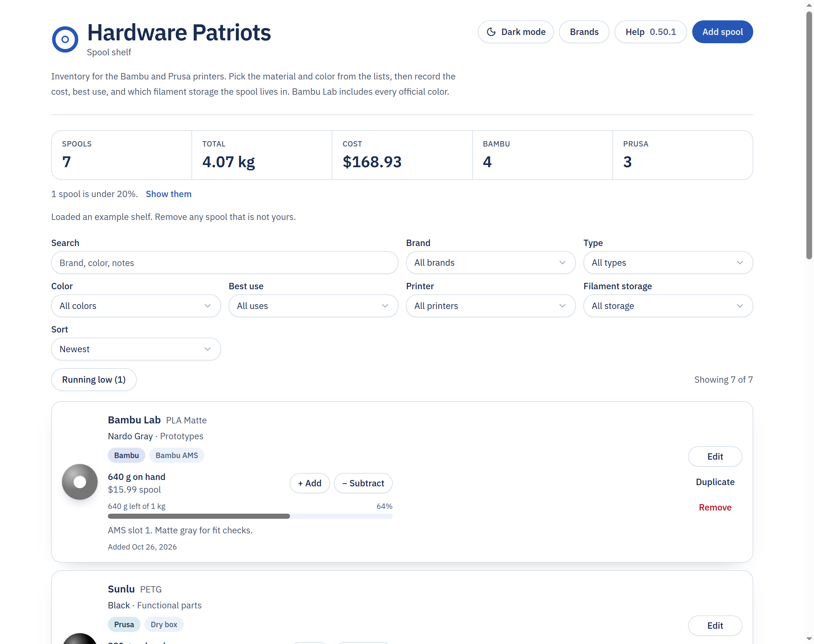
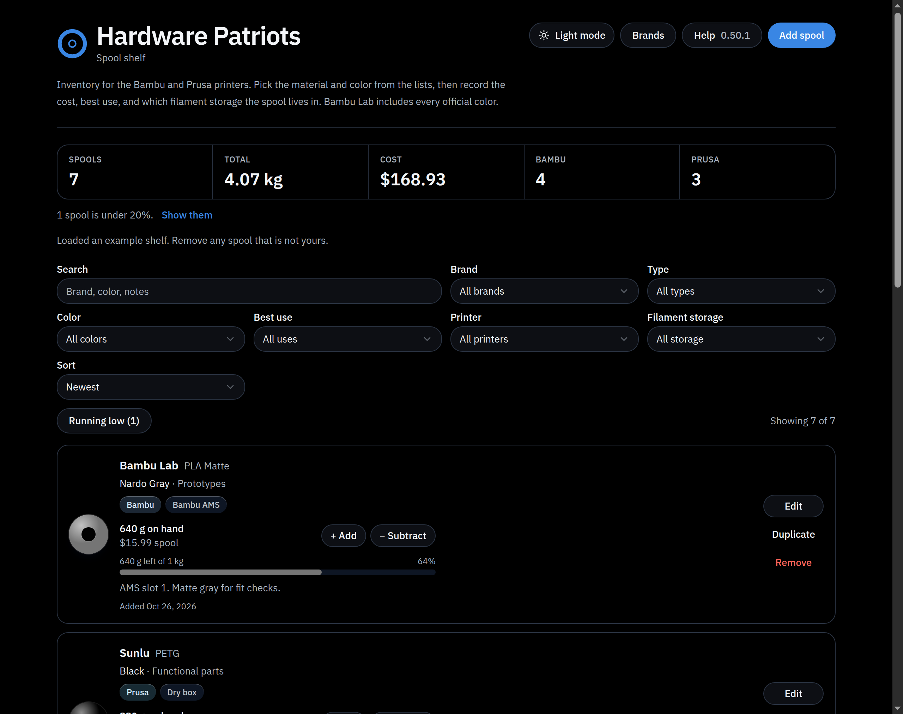

# Hardware Patriots

What changed is in [CHANGELOG.md](CHANGELOG.md).

Filament shelf for the printers on the bench. Each spool keeps its brand, material, color, best use, printer, and where it sits. The shelf stays on this computer.

Brands in the list: Bambu Lab, Sunlu, Fiberon, Siraya Tech, American Filament, 3DFuel, and Prusament. Add another brand from **Add spool** or **Brands**.

Materials include PLA, PETG, PETG Matte, PETG HF, ABS, ABS-CF, ABS-GF, ASA, ASA-CF, ASA-GF, PC-CF, PA6-CF, PA12-CF, and PA612-CF. Bambu PETG Matte is brand Bambu Lab and type PETG Matte. Prusament PC-CF is brand Prusament and type PC-CF. Sunlu PA6-CF, PA12-CF, and PA612-CF are brand Sunlu and those types.

Printers are Bambu and Prusa.

Each spool shows the grams on hand and what that spool cost. **+ Add** and **− Subtract** change the grams in grams or kilograms. The shelf **Total** updates right away and stays after a refresh. A spool cannot go below zero. Every change keeps the date, time, amount, and a reason.

Bambu Lab spools use Bambu’s official colors for each material, such as PLA Basic Jade White and PLA Matte Nardo Gray. The cost starts from the price Bambu Studio lists for that material. Change it if you paid something else. The shelf **Cost** adds those spool prices together.

## Downloads

The programs on the release page today are version 0.50.1. This folder is version 1.0.0. After you push it, run **Actions → Release installers → Run workflow**. When that run is green, download the files named **1.0.0**. The Windows file is a program. It ends in `.exe`, so it is not a zip. Do not unzip it. Open it.

| Computer | Download | About this size |
| --- | --- | --- |
| Windows | [Hardware-Patriots-Setup-0.50.1-win-x64.exe](https://github.com/Lordnikoncanon/hardware-patriots-source/releases/download/v0.50.1/Hardware-Patriots-Setup-0.50.1-win-x64.exe) | 147 MB |
| Mac, Apple silicon | [Hardware-Patriots-0.50.1-mac-arm64.zip](https://github.com/Lordnikoncanon/hardware-patriots-source/releases/download/v0.50.1/Hardware-Patriots-0.50.1-mac-arm64.zip) | 182 MB |
| Mac, Intel | [Hardware-Patriots-0.50.1-mac-x64.zip](https://github.com/Lordnikoncanon/hardware-patriots-source/releases/download/v0.50.1/Hardware-Patriots-0.50.1-mac-x64.zip) | 186 MB |
| Linux | [Hardware-Patriots-0.50.1-linux-x86_64.AppImage](https://github.com/Lordnikoncanon/hardware-patriots-source/releases/download/v0.50.1/Hardware-Patriots-0.50.1-linux-x86_64.AppImage) | 241 MB |

Skip the files that end in `.dmg` or `.deb` unless you know you want those. Skip **Source code** at the bottom of the release. That is the project files, not the program.

If the browser says the file is dangerous, open the download arrow and choose Keep. A finished Windows download is about 147 MB. A file that is only a few KB did not finish, and it will not open.

These builds are unsigned, for testing. Windows SmartScreen and macOS Gatekeeper warn the first time you open one. On Windows, click More info, then Run anyway. On a Mac, right-click the app and choose Open.

## Screenshots





Put another picture in the `screenshots` folder, then add a line like `` to this file. GitHub shows that picture on the main page.

## Run it while you work on it

```bash
npm install
npm run dev
```

Open http://127.0.0.1:41783

## Build the desktop app

```bash
npm install
npm run desktop:pack
```

The installers are written to `release/`.
