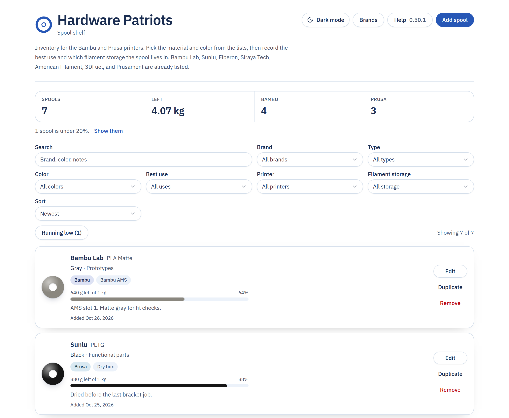
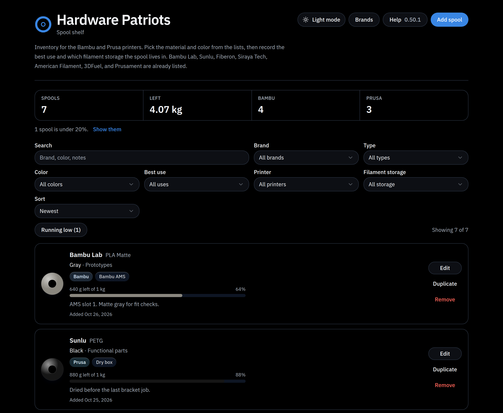

# Hardware Patriots

Filament shelf for the printers on the bench. Each spool keeps its brand, material, color, best use, printer, and where it sits. The shelf stays on this computer.

Brands in the list: Bambu Lab, Sunlu, Fiberon, Siraya Tech, American Filament, 3DFuel, and Prusament. Add another brand from **Add spool** or **Brands**.

Materials include PLA, PETG, PETG Matte, PETG HF, ABS, ABS-CF, ABS-GF, ASA, ASA-CF, ASA-GF, PC-CF, PA6-CF, PA12-CF, and PA612-CF. Bambu PETG Matte is brand Bambu Lab and type PETG Matte. Prusament PC-CF is brand Prusament and type PC-CF. Sunlu PA6-CF, PA12-CF, and PA612-CF are brand Sunlu and those types.

Printers are Bambu and Prusa.

## Downloads

The Windows, Mac, and Linux installers are on the [Releases](https://github.com/Lordnikoncanon/hardware-patriots-source/releases) page. Download the file for your computer from there.

To publish a new set, open the **Actions** tab, choose **Release installers**, and click **Run workflow**. When the run is green, the installers are attached to the release.

## Screenshots





Put another picture in the `screenshots` folder, then add a line like `` to this file. GitHub shows that picture on the main page.

## Run it while you work on it

```bash
npm install
npm run dev
```

Open http://127.0.0.1:41783

## Build the desktop app

```bash
npm install
npm run desktop:pack
```

The installers are written to `release/`.

| System | File |
| --- | --- |
| Windows | `Hardware-Patriots-Setup-0.50.1-win-x64.exe` |
| Mac, Apple silicon | `Hardware-Patriots-0.50.1-mac-arm64.zip` |
| Mac, Intel | `Hardware-Patriots-0.50.1-mac-x64.zip` |
| Linux | `Hardware-Patriots-0.50.1-linux-x64.AppImage` or the `.deb` |

These builds are unsigned, for testing. Windows SmartScreen and macOS Gatekeeper warn the first time you open one. On a Mac, right-click the app and choose Open.
