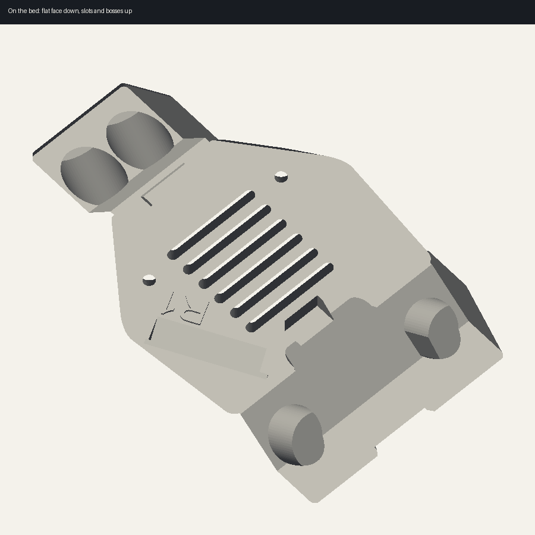

# Hardware Patriots

Desktop filament inventory for the Bambu and Prusa printers on the bench. Each spool records the brand, material, color, best use, printer, and printer case, plus how much is left. The shelf is saved on this computer. Nothing is sent to a server.

These brands start in the dropdown: Bambu Lab, Sunlu, Fiberon, Siraya Tech, American Filament, 3DFuel, and Prusament. Add any other brand from **Add spool** or **Brands**.

Materials include PETG Matte, PETG HF, ABS-CF, ASA-CF, ABS-GF, and ASA-GF, along with PLA, PETG, ABS, and ASA. Bambu PETG Matte is brand Bambu Lab and type PETG Matte.

Type, color, best use, printer, and printer case are dropdowns. Printers are Bambu and Prusa. Printer cases include the AMS, spool holders, the Prusa enclosure, a dry box, a sealed bag, and an open shelf.

## Installers

Test builds are unsigned. Windows SmartScreen and macOS Gatekeeper will warn the first time you open one. On a Mac, right-click the app and choose Open.

The installer files are stored in `installers/parts` in pieces. Join them after you clone:

```bash
node scripts/assemble-installers.mjs
```

| System | Installer |
| --- | --- |
| Windows | `Hardware-Patriots-Setup-0.1.0-win-x64.exe` |
| Mac, Apple silicon | `Hardware-Patriots-0.1.0-mac-arm64.zip` |
| Mac, Intel | `Hardware-Patriots-0.1.0-mac-x64.zip` |
| Linux | `Hardware-Patriots-0.1.0-linux-x64.AppImage` or the `.deb` |

On Windows, run the setup exe and launch **Hardware Patriots** from the Start menu. On a Mac, unzip and open `Hardware Patriots.app`. On Linux, mark the AppImage executable and run it, or install the `.deb`.

Build the installers from a checkout:

```bash
npm install
npm run desktop:pack
```

The files land in `release/`. Linux and Windows packages are built with electron-builder. The Mac zip is assembled here from the official Electron Mac runtime, because a Mac disk image has to be signed on a Mac. These builds are for testing, not for a store.

To open the shelf on this machine while working on it, after `npm run build`:

```bash
npm run desktop:start
```

## Camera mount — PrusaSlicer 2.9.6

Print profile for `camera-mount.stl` on a **Prusa CORE One+ (Gen 2)** with **Bambu Lab PETG Matte** and the stock **0.4 mm high-flow nozzle**.

PrusaSlicer 2.9.6 does not have a separate Gen 2 printer preset. Gen 2 uses the system profile **Prusa CORE One HF0.4 nozzle**. In the printer list that model is **Prusa CORE One && CORE One+**.

The STL was exported tilted and far from the origin (about 62 mm on each axis of its bounding box). The project file lays it flat: **85.2 × 51.8 × 11.2 mm**, flat face on the bed, slots and round bosses toward the nozzle. Model volume is 11.0 cm³.



## Open and slice

1. In PrusaSlicer 2.9.6, run **Configuration → Configuration Wizard** once and install **Prusa CORE One** with the **0.4 mm HF** nozzle, if that printer is not already in the list.
2. **File → Open** `camera-mount.3mf`.
3. The plate should show three system presets, each with a few modified values:
   - Printer: `Prusa CORE One HF0.4 nozzle`
   - Print: `0.20mm BALANCED @COREONE HF0.4`
   - Filament: `Generic PETG @COREONE HF0.4`
4. Slice. The printer wants binary G-code (`.bgcode`). Send that to the CORE One.

On the printer, set **Settings → Hardware → Edition** to **CORE One+ (Gen 2)** so the nozzle wiper, belts, and bed joints match the machine. That switch lives in firmware. The 2.9.6 start G-code does not call the wiper itself. The G-code asks for firmware 6.5.3 or newer; Gen 2 firmware (6.8.1 and later) satisfies that.

If you installed a standard (not high-flow) 0.4 mm nozzle, do not use this profile. Switch the printer to `Prusa CORE One 0.4 nozzle` and the filament base to `Generic PETG @COREONE`.

## Save the presets for other parts

**File → Import → Import Config** and choose `profiles/Bambu-Lab-PETG-Matte-COREONE.ini`.

That adds two user presets, both built on the 2.9.6 system profiles:

| Preset | Inherits |
| --- | --- |
| `Bambu Lab PETG Matte @COREONE HF0.4` | `Generic PETG @COREONE HF0.4` |
| `0.20mm Camera Mount @COREONE HF0.4` | `0.20mm BALANCED @COREONE HF0.4` |

Set the filament color to the spool you loaded. The preset uses a neutral gray.

## Filament

Bambu’s own 0.4 mm PETG Matte profile (X1C / P1S in Bambu Studio) supplies the material limits. Cooling, retraction, pressure advance, and the bed temperature stay on Prusa’s CORE One PETG profile, because those are tuned for this hotend, fan, and sheet.

| Setting | Value | Where it comes from |
| --- | --- | --- |
| Nozzle, first layer | 245 °C | Bambu PETG Matte, 0.4 mm |
| Nozzle, other layers | 250 °C | Bambu PETG Matte, 0.4 mm |
| Nozzle range on the Bambu profile | 230–270 °C | do not leave this band |
| Bed, first layer and other layers | 85 °C | Prusa `Generic PETG @COREONE HF0.4` |
| Max volumetric speed | 15 mm³/s | Bambu PETG Matte, 0.4 mm |
| Extrusion multiplier | 1.00 | Prusa PETG on the Nextruder |
| Density (weight estimate only) | 1.37 g/cm³ | Bambu PETG Matte profile |
| Fan | 30–60% | CORE One PETG |
| Fan off | first 3 layers | CORE One PETG |
| Full fan | layer 5 | CORE One PETG |
| Bridges and overhangs | 60% fan | CORE One PETG |
| Slow down under | 9 s layer time, floor 15 mm/s | CORE One PETG |
| Fan starts ramping under | 25 s layer time | CORE One PETG |
| Retraction | 0.8 mm, lift 0.15 mm, wipe on | CORE One PETG filament |
| Pressure advance | `M572 S0.047` | CORE One PETG, 0.4 mm nozzle |
| Chamber | 35 °C nominal, no wait | CORE One PETG |

Bambu’s plate temperature for this filament is 70 °C. That is for a Bambu plate. On the CORE One sheet, Prusa’s PETG profiles use 85 °C, and that is what this project uses. On a smooth PEI sheet, wipe on a thin layer of glue stick so PETG releases after it cools.

15 mm³/s is the cap that actually limits speed. At 0.20 mm layers and 0.45 mm width, that is about 167 mm/s. The balanced profile’s 200 mm/s outer wall is pulled down to that. Prusa’s generic PETG profile allows 21 mm³/s on this nozzle; that is too fast for this matte blend.

Bambu Studio’s flow ratio for PETG Matte is 0.95. This preset leaves the multiplier at 1.00, which is what Prusa uses for PETG on this extruder. Print a single-wall cube, measure it, and lower the multiplier if the wall is wider than the slicer expects.

If the spool strings or pops, dry it at 65 °C for 12 hours before printing. That is Bambu’s drying temperature for this filament.

## Print

Base profile: **0.20mm BALANCED @COREONE HF0.4**, which is the default print profile for this nozzle. These are the values that differ, because the part is a thin mount with screw holes and bosses:

| Setting | This part | Balanced default |
| --- | --- | --- |
| Layer height | 0.20 mm | 0.20 mm |
| First layer height | 0.20 mm | 0.20 mm |
| Perimeters | 4 | 2 |
| Infill | 30% gyroid | 15% grid |
| Top solid layers | 5 | 5 |
| Bottom solid layers | 4 | 3 |
| Supports | off | on, where detected |
| Avoid crossing perimeters | on | off |

Everything else stays on the balanced profile:

- Perimeter / infill / solid extrusion width 0.45 mm, first layer 0.50 mm, top infill 0.42 mm
- First layer 45 mm/s, outer wall 200 mm/s, inner wall 150 mm/s, infill 150 mm/s, top solid 100 mm/s, bridges 50 mm/s, travel 350 mm/s
- Overhang speeds 15 / 25 / 50 mm/s, then 70%
- Elephant foot compensation 0.2 mm
- Seam aligned, Arachne walls
- Accelerations: first layer 500, outer wall 2500, inner wall 3000, infill 5000 mm/s²

Four walls and 30% gyroid keep the bosses and the holes from relying on sparse grid infill. Supports stay off: the flat face is about 1900 mm² and sits on the bed, and the bosses are on top. The bed side has shallow recesses about 1.4 mm deep; they bridge. PETG supports on those pockets tend to weld on. Turn supports back on (snug, from the build plate) only if a sliced layer preview shows a boss hanging in the air.

Avoid crossing perimeters keeps travels from stringing across the slots.

## Files

| File | What it is |
| --- | --- |
| `camera-mount.3mf` | Oriented model plus the profile overrides. Open this. |
| `profiles/Bambu-Lab-PETG-Matte-COREONE.ini` | Reusable filament and print presets. Import once. |
| `models/camera-mount.stl` | Original mesh, as exported. |
| `models/camera-mount-oriented.stl` | Same mesh, flat on the bed, if you already have a project open. |
